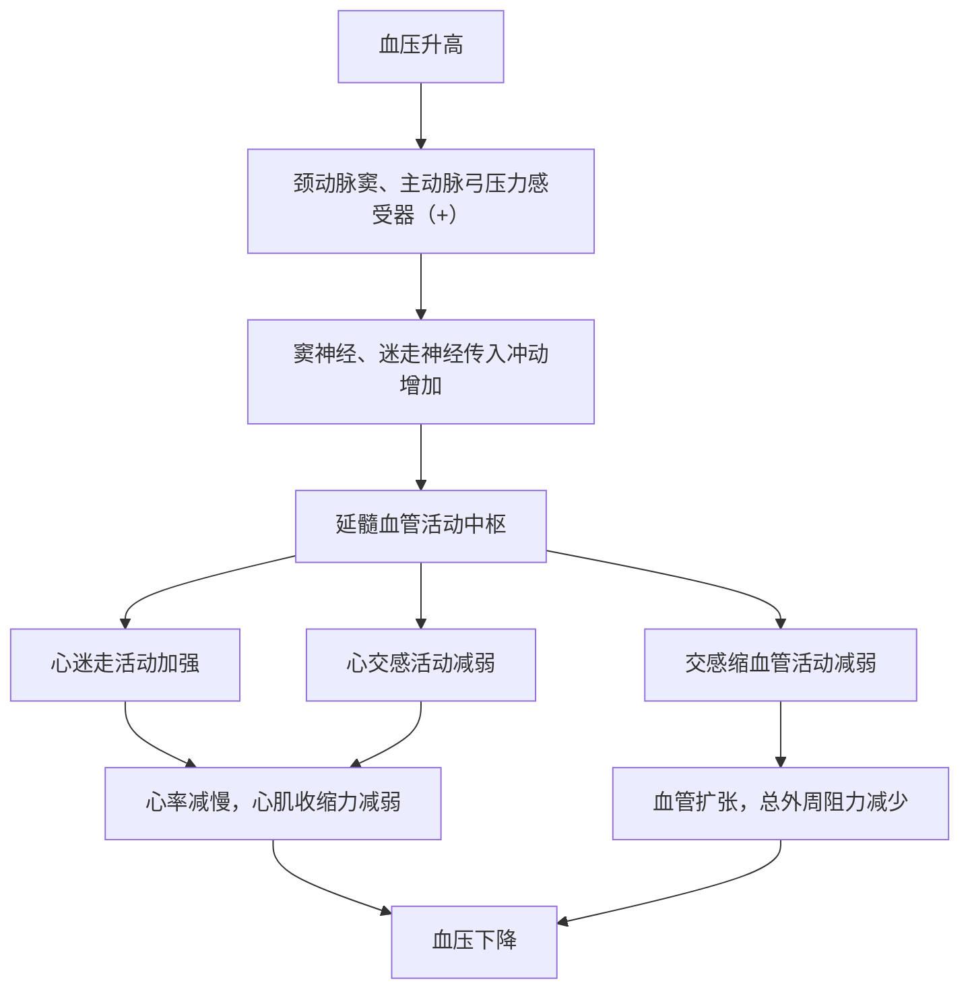

标签：[[生物]] [[生理学]] [[过程]] [[血管]] [[心脏]] [[血液]]
# 自身调节
1. 异长自身调节（Starling机制）
	1. 心室舒张末期容积与心室收缩力正相关
	2. 心室长度相当于前负荷，在一定范围内，前负荷越大拉力越大
	3. 末期容积=静脉回心血量+射血后血量
	4. 影响静脉回心血量因素：
		1. 心室舒张充盈持续时间
		2. 静脉回流速度
	5. 后负荷对搏出量影响：
		1. 大动脉血压
		2. 一般后负荷不会对泵血量造成太大影响，因为心肌会代偿性的增大收缩力
2. 等长自身调节：
	1. 影响心脏兴奋-收缩偶联的因素都可以影响心肌收缩能力
	2. 如钙离子、ATP酶活性、活化横桥数等
# 血管调节
1. 肌源性：平时保持紧张性收缩，受到牵拉时会增强
2. 代谢性自身调节
	1. ![[PixPin_2026-06-17_14-54-15.png]]
	2. 
# 神经系统的调节
1. [[自主神经系统]]
2. 反射调节：心脏受心交感神经和心迷走神经支配，由脊髓发出
	1. 心交感神经：
		1. 支配窦房结、房室交界、房室束、心房肌、心室肌
		2. 增强心脏收缩
		3. 释放去甲肾上腺素，作用于心肌细胞膜上$\beta_{1}$受体，引起cAMP增加
			1. 正性变时作用：窦房结自律性加强，心率增快
			2. 正性变传导作用：房室结节传导心率速度增快，钙内流加快
			3. 正性变力作用：心房肌心室肌收缩加强
	2. 心迷走神经：
		1. 释放ACh，作用于心肌细胞M受体，导致cAMP浓度降低
		2. 负性变时作用：钾离子外流，心率减慢
		3. 负性变传导作用
		4. 负性变力作用
3. 血管的神经支配：
	1. 缩血管纤维
		1. 分布：皮肤>骨骼肌，内脏>冠状动脉，脑
		2. 效应：释放去甲肾上腺素，产生舒缩血管/平滑肌效应（$\alpha$受体结合导致收缩，$\beta_{2}$受体结合导致舒张），由于去甲肾上腺素对$\alpha$亲和力大于$\beta_{2}$，因此宏观表现出收缩效应
		3. 有规律性发放，平时1-3次/s，紧张时4-6次/s
	2. 舒血管纤维
		1. 交感舒血管纤维：Ach，舒张骨骼肌血管，无紧张性活动，激动/防御反应时发放冲动
		2. 副交感舒血管纤维：调节器官局部血流
4. 心血管反射中枢：心血管反射有关神经元集中的区域或核团的部位为心血管反射中枢（或许可以参考[[脑]]）
	1. 延髓：基本，心迷走神经元+控制心交感神经&交感缩血管神经元活动的神经元
		1. 缩血管区：位于延髓头端的腹外侧部的C1区，交感缩血管+心交感神经元胞体所在部位
		2. 舒血管区：延髓尾端腹外侧部的A1区，兴奋时抑制缩血管区神经元活动，使血管舒张
		3. 传入神经接替站：孤束核
		4. 心抑制区：迷走神经背核、疑核
		5. ![[PixPin_2026-06-24_22-22-00.png]]
	2. 延髓以上？
# 压力感受性反射
1. 作用：使心率减慢，外周血管阻力降低，血压降低
2. 感受器：颈动脉窦+主动脉弓，感受血管壁牵张程度
3. 窦神经和迷走神经进入延髓，汇入孤束核中
	1. 孤束核：抑制交感紧张性活动（by抑制腹外侧区缩血管区神经元、影响其他神经元），加强迷走活动
4. 传出：心交感、心迷走、交感缩血管神经
5. 可以缓冲动脉血压变化，调节血压快速变化，避免忽然血压上升暴死
过程如下：

# 体液调节
1. 全身性因素：
	1. 去甲肾上腺素&肾上腺素（儿茶酚胺类激素），来自肾上腺髓质
		1. 肾上腺素：$\beta_{1}$（心脏三正效应）、$\beta_{2}$（骨骼肌、肝脏舒张）、$\beta_{1}$（皮肤、胃肠道收缩）
		2. 去甲肾上腺素：$\alpha$（收缩），$\beta_{1}$，$\beta_{2}$弱
		3. 肾上腺素导致心输出量增大、外周阻力下降、动脉收缩压上升、舒张下降，平均动脉压不变（由于三正作用，心输出量增大；外周血管舒张，阻力下降；两相结合导致平均动脉压几乎不变）
		4. 去甲肾上腺素导致外周阻力上升，所有动脉血压上升，心输出量不变（显著激活$\alpha$和$\beta_{1}$受体，导致阻力上升；同时由于没有激活$\beta_{2}$受体导致触发压力感受反射，全身血管收缩导致迷走神经激活抑制心脏搏动，从而导致心输出量保持稳定。故所有动脉压稳定上升）
		5. ![[PixPin_2026-04-08_17-47-20.png]]
	2. 肾素-血液紧张素系统
		1. ![[PixPin_2026-04-08_17-49-52.png]]
		2. 血管紧张素受体（AT受体）：AT1，AT2，AT3，AT4 受体
		3. 血管紧张素II作用于血管平滑肌，使全身微动脉收缩，血压升高。是==已知的最强缩血管物质之一==，同时刺激肾上腺皮质球状带细胞合成和释放醛固酮，增加细胞外液，升高血压
		4. 血管紧张素I不具生物活性
		5. 血管紧张素III与II有相似的生物效应，但是缩血管效应仅为血管紧张素的10%~20%
		6. 升血压机制约需20min才能全部生效，启动慢但持续时间长